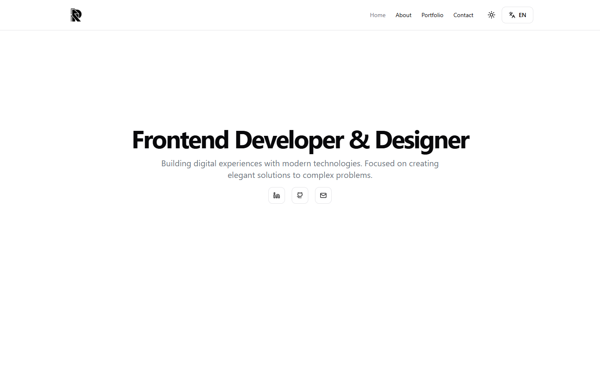

# Roberto Jordán

Bilingual portfolio for a frontend developer and designer, built with Next.js 14, TypeScript and Tailwind CSS.



## What it is

A four-page portfolio (home, about, portfolio, contact) in English and Spanish, with light and dark themes. Project cards, skills, service lists and copy are driven by one JSON file per language, and the contact form sends email through EmailJS.

It is a static front end: there is no CMS, database, authentication or payment flow, and the project entries are hand-maintained rather than fetched from an API.

## Why this over a portfolio template

- **Two locales from a single source.** `messages/en.json` is the source of truth and `messages/es.json` mirrors it; `src/i18n.ts` validates the locale and loads the right file.
- **No remote media.** Logos, avatar, illustrations and the seven project previews live in `public/img` and are served from the deployment.
- **Content separated from components.** Copy, project links, skills and chart values are data, so adding a project is a JSON edit, not a component rewrite.
- **Theme by tokens.** Colours are CSS variables in `globals.css`; light and dark mode use the same component tree.
- **Small dependency surface for the job.** shadcn/ui primitives, `next-intl`, framer-motion for the intro animation and recharts for the skill charts.
- **Typed and linted.** `tsc --noEmit` and `next lint` run clean, and the production build is verified.

## Quick start

Requirements: Node.js 20 or newer and npm.

```bash
git clone git@github.com:JORDANROBERTO74/roberto-jordan-portfolio.git
cd roberto-jordan-portfolio
npm install
npm run dev
```

Open <http://localhost:3000>; the root redirects to `/en`.

| Command | What it does |
| --- | --- |
| `npm run dev` | Start the development server |
| `npm run build` | Create an optimized production build |
| `npm run start` | Serve the production build |
| `npm run lint` | Run ESLint |
| `npm run typecheck` | Run `tsc --noEmit` |

## Internationalization

`src/middleware.ts` lists the supported locales (`en`, `es`) and the default (`en`). `src/i18n.ts` rejects any other locale with a 404 and imports `messages/{locale}.json`. The language switcher in `src/components/local-switcher.tsx` reads its options from `header.languageButton.languages` in each message file, so adding a language means a new JSON file plus two entries in the middleware.

Dates and copy are written per locale; there is no runtime translation service.

## Content model

`messages/en.json` and `messages/es.json` hold the whole site: navigation, footer, page headings, skills, skill-chart values, and the `projects` array used by the cards (name, description, preview image, repository URL, demo URL). Components read it with `useMessages()`; there is no separate content layer to keep in sync.

## Contact form

`src/app/[locale]/contact/page.tsx` renders a `react-hook-form` form validated with Zod. `src/hooks/useContactForm.ts` wraps the mutation and `src/lib/sendContactForm.ts` calls EmailJS with three build-time variables:

```bash
NEXT_PUBLIC_EMAILJS_SERVICE_ID=
NEXT_PUBLIC_EMAILJS_TEMPLATE_ID=
NEXT_PUBLIC_EMAILJS_PUBLIC_KEY=
```

Set them in `.env.local` for development and in the hosting project for production. Without them the form renders but sending fails and shows the error state.

## Project structure

```text
src/
  app/
    [locale]/
      layout.tsx      metadata, fonts, providers, header and footer
      page.tsx        home
      about/          about
      portfolio/      project list
      contact/        contact form
      globals.css     theme tokens
    page.tsx          redirects / to /en
  components/
    navigation/       header, footer, main content wrapper
    ui/               shadcn/ui primitives
    home.tsx          home sections
  hooks/              contact form mutation
  lib/                EmailJS call and class-name helper
  i18n.ts             locale validation and message loading
  middleware.ts       locale routing
messages/             en.json, es.json
public/img/           self-hosted logos, avatar, illustrations and project previews
```

## Deployment

The project deploys to Vercel with the default Next.js preset: `npm run build`, output handled by the platform. Add the three `NEXT_PUBLIC_EMAILJS_*` variables to the project before the first production build, because Next.js inlines `NEXT_PUBLIC_` values at build time.

No custom domain is configured.

## Status and scope

Verified: `npm run typecheck`, `npm run lint`, `npm run build`, and headless checks of `/en`, `/es` and the about, portfolio and contact routes in both locales at 1440×900 and 390×844 with no console errors or horizontal overflow.

Known limits: the contact form is not exercised end to end (a real submission would send an email); there is no `sitemap.xml`, `robots.txt` or Open Graph image; the animated intro delays the home and about copy for a few seconds; and `npm audit` still reports advisories in Next.js 14 and `next-intl` 3 that need major-version upgrades.

## License

MIT. See [LICENSE](LICENSE). Photography and the project previews are excluded from the license.
